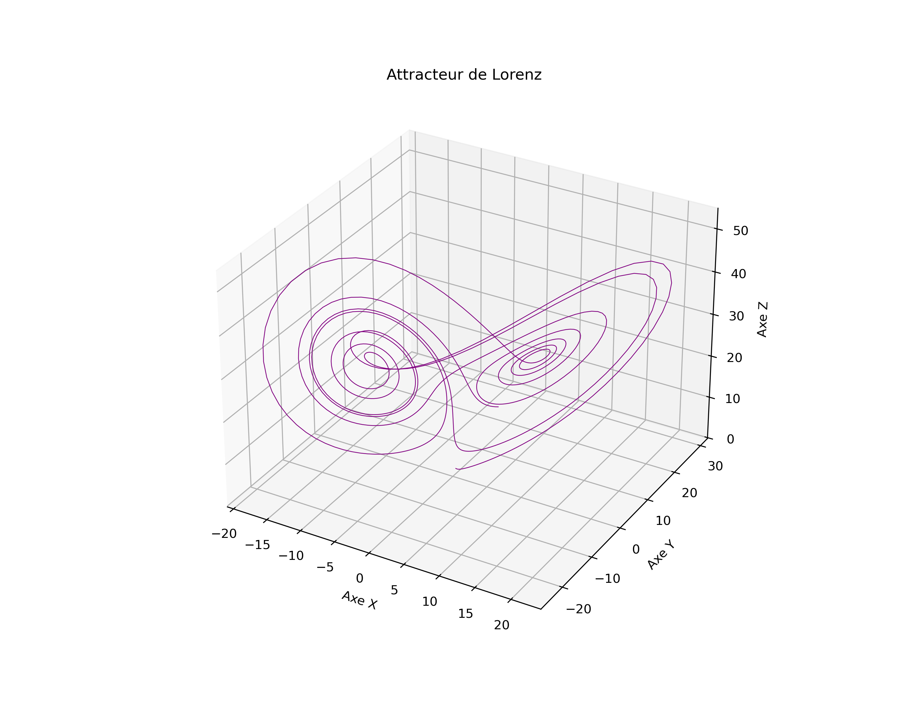

# Lorenz Attractor Simulation in Fortran 95

A numerical simulation of the chaotic **Lorenz dynamical system** implemented in modern Fortran 95, coupled with an automated Python 3D visualization pipeline.



---

## Overview

The **Lorenz system** is a system of three coupled, nonlinear ordinary differential equations first studied by Edward Lorenz in 1963 to model atmospheric convection. It is renowned for exhibiting deterministic chaos and the iconic "butterfly" strange attractor.

### Mathematical Formulation

The governing equations are:

$$\frac{dx}{dt} = \sigma (y - x)$$

$$\frac{dy}{dt} = x (\rho - z) - y$$

$$\frac{dz}{dt} = x y - \beta z$$

#### Default Parameters & Initial Conditions

- **Prandtl number** ($\sigma$): `10.0`
- **Rayleigh number** ($\rho$): `28.0`
- **Geometric factor** ($\beta$): $\frac{8}{3} \approx 2.6667$
- **Initial state** $(x_0, y_0, z_0)$: `(0.02, 0.95, 1.12)`
- **Time span**: $t \in [0.0, 10.0]$ with time step $\Delta t = 0.01$

---

## Project Structure

```text
.
├── lorenz_config.f95        # Fortran module: parameters, types, Euler solver, CSV export
├── main.f95                 # Main driver: allocates arrays, runs simulation, invokes Python
├── plot_solutions_script.py # Python script: loads CSV and renders 3D Matplotlib plot
├── solutions_lorenz_euler.png # Generated 3D trajectory plot (300 DPI)
├── .gitignore               # Ignored build objects, binaries, and generated data
└── README.md                # Project documentation
```

### Component Details

- **`lorenz_config.f95`**:
  - Derived types: `parameters`, `init`, and `time_config`.
  - `simulate_lorenz_euler`: Implements the numerical integration of the Lorenz equations using the forward Euler method.
  - `save_solutions_csv`: Exports the computed time series $(t, x, y, z)$ into CSV format.
- **`main.f95`**:
  - Initializes parameters, initial conditions, and time discretization.
  - Dynamically allocates solution vectors with allocation status checks.
  - Calls the numerical simulation and CSV exporter.
  - Automatically triggers the Python plotting script via Fortran 2008's `execute_command_line`.
- **`plot_solutions_script.py`**:
  - Reads the simulation data using `pandas`.
  - Plots the 3D phase-space trajectory with `matplotlib`.
  - Exports a high-resolution figure (`solutions_lorenz_euler.png`) and opens an interactive window.

---

## Prerequisites (Ubuntu / Linux)

Ensure you have the GNU Fortran compiler (`gfortran`) and Python 3 with the required scientific libraries installed:

```bash
# Install GNU Fortran compiler
sudo apt update
sudo apt install gfortran python3 python3-pip

# Install Python plotting dependencies
pip3 install pandas matplotlib
```

---

## Build and Run

To compile the module, link the executable, and run the complete simulation and visualization pipeline in a single command from your terminal:

```bash
gfortran -c lorenz_config.f95 ; gfortran main.f95 lorenz_config.o -o main; ./main
```

### Command Breakdown

1. **`gfortran -c lorenz_config.f95`**: Compiles the `lorenz_config` module into an object file (`lorenz_config.o`) and generates the Fortran module interface (`lorenz_config.mod`).
2. **`gfortran main.f95 lorenz_config.o -o main`**: Compiles the main program and links it against `lorenz_config.o` to produce the executable binary `main`.
3. **`./main`**: Executes the simulation, displays console previews of the first 10 solution points, saves the CSV file, and invokes the Python 3D plot script.

---

## Output Files

- **`solutions_lorenz_euler.csv`**: Tabular time-series containing columns `t, x, y, z`.
- **`solutions_lorenz_euler.png`**: 3D phase space visualization rendered at 300 DPI.
